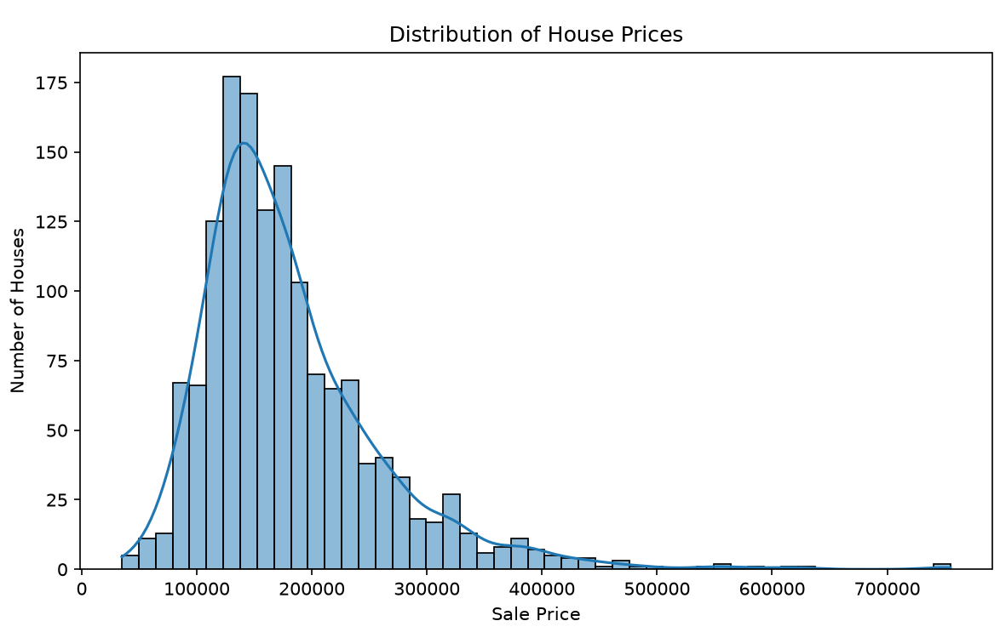
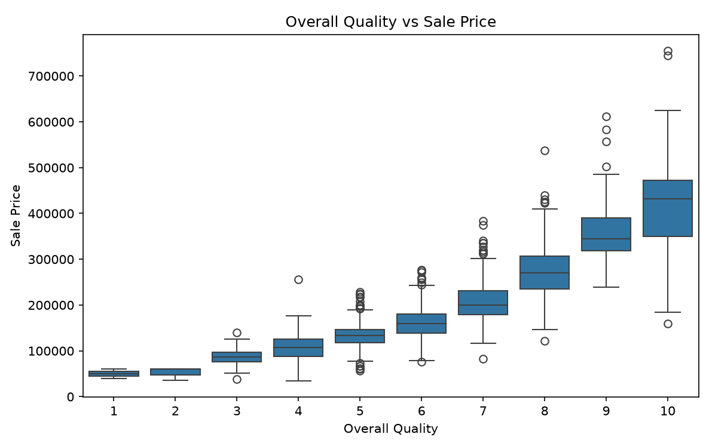
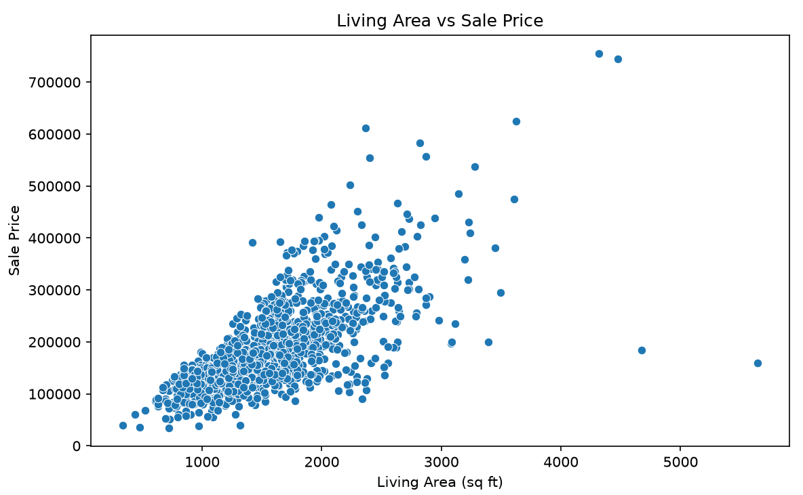
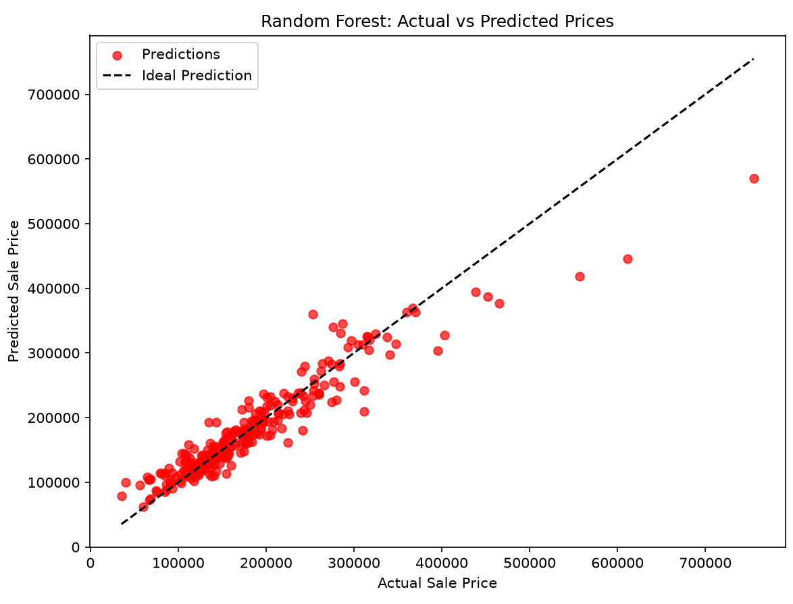
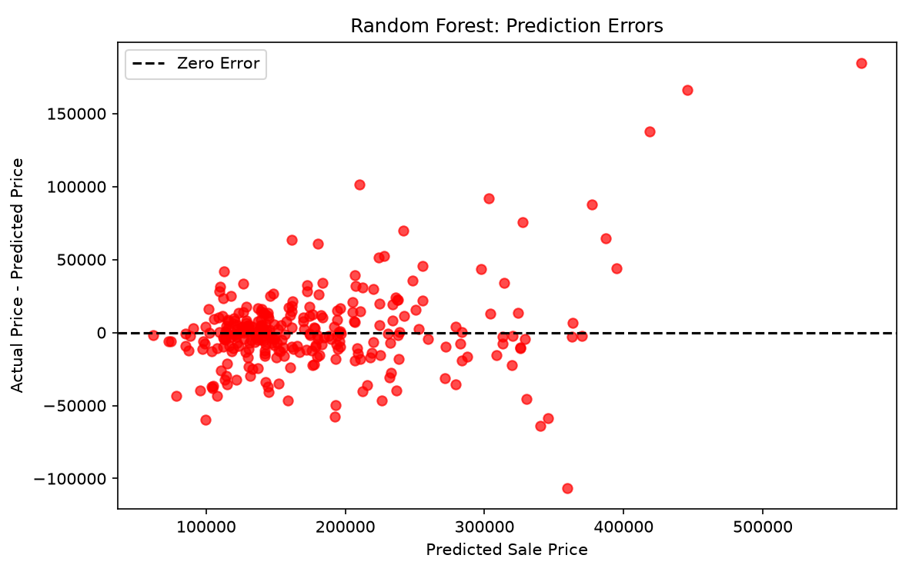

# House Price Prediction 🏡

A Machine Learning project that predicts house prices using housing features. This project explores the dataset, trains regression models, compares their performance, and visualizes prediction results.

## Project Overview

The main goal of this project is to build a machine learning model that predicts house sale prices and understand the complete workflow, from data exploration to model evaluation.

## Technologies Used

- Python
- Pandas
- NumPy
- Matplotlib
- Seaborn
- Scikit-learn
- Joblib

## Dataset

- Dataset: Kaggle House Prices
- Total Rows: 1,460
- Total Columns: 81
- Target Variable: `SalePrice`

## Project Structure

House-Price-Prediction/

- data/
  - train.csv
- screenshots/
  - 01_saleprice_histogram.png
  - 02_overallqual_vs_saleprice.png
  - 03_grlivarea_vs_saleprice.png
  - 04_actual_vs_predicted.png
  - 05_residual_plot.png
- house_price.py
- predict_house.py
- house_price_model.pkl
- README.md

## Exploratory Data Analysis (EDA)

### 1. SalePrice Distribution

This histogram shows how house sale prices are distributed in the dataset.

### 2. Overall Quality vs Sale Price

This graph shows the relationship between house quality and sale price.

### 3. Living Area vs Sale Price

This graph shows the relationship between above-ground living area and house sale price.

## Machine Learning Models

Two regression models were trained and compared.

### Linear Regression

A regression algorithm that learns the relationship between house features and their prices.

### Random Forest Regressor

An ensemble algorithm that combines multiple decision trees to predict house prices.

## Model Evaluation

The models were evaluated using MAE, RMSE, and R² Score.

| Model | MAE | RMSE | R² Score |
|---|---:|---:|---:|
| Linear Regression | 20,470.31 | 31,042.67 | 0.8744 |
| Random Forest | 17,788.78 | 29,150.85 | 0.8892 |

These are earlier evaluation results. Update them if your latest run produces different values.

Random Forest performed better than Linear Regression on the evaluated test split.

## Model Evaluation Graphs

### 4. Actual vs Predicted Prices

This graph compares actual house prices with model predictions. Points closer to the diagonal line indicate more accurate predictions.

### 5. Residual Plot

This graph shows prediction errors and helps us understand where the model's predictions differ from actual prices.

Residual = Actual Price - Predicted Price

## Project Workflow

1. Load the dataset using Pandas.
2. Explore the data and check missing values.
3. Separate features and target variable.
4. Split the data into training and testing sets.
5. Handle missing values and encode categorical features.
6. Train Linear Regression and Random Forest models.
7. Evaluate model performance using MAE, RMSE, and R².
8. Visualize actual prices, predictions, and residuals.
9. Save the trained model using Joblib.

## How to Run

Install the required libraries:

    python -m pip install pandas numpy matplotlib seaborn scikit-learn joblib

Run the main project:

    python house_price.py

Run the prediction demonstration after the model has been saved:

    python predict_house.py

## Saved Model

The trained pipeline is saved as `house_price_model.pkl` and can be loaded for future predictions.

## Limitations

- Predictions depend on the dataset used for training.
- Performance may vary on unseen housing data.
- The current prediction script is a demonstration, not a complete web application.

## Future Improvements

- Hyperparameter tuning
- Cross-validation
- Feature importance analysis
- Interactive web application using Flask or Streamlit
- Predictions based on user-entered house features

## Conclusion

This project demonstrates a complete beginner-level machine learning workflow, including data exploration, preprocessing, model training, evaluation, visualization, and model saving.
